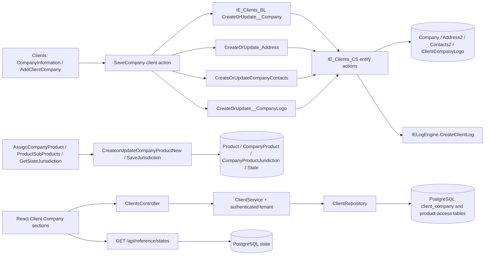

# Client Company OutSystems source mapping

## Evidence and scope

This mapping was produced from the supplied binary artifacts, not inferred from the React UI. `Input/Clients.oml`, `Input/IE_Clients_BL.oml`, and `Input/IE_Clients_CS.oml` were decoded to XML with the open-source `oml-utilities` extractor. `Input/InsureEdge2.0 Clients.oap` was opened as a ZIP package; its `InsureEdge2_0_Clients/Clients.oml` contains the packaged copy of the Clients module. The extracted XML was searched across screens, blocks, structures, reference entities, aggregates, client actions, server actions, and referenced service methods.

The relevant module split is:

- `Clients`: reactive screens/blocks, UI data actions, and orchestration actions.
- `IE_Clients_BL`: public service actions used by `Clients`.
- `IE_Clients_CS`: entity CRUD, audit calls to `IELogEngine.CreateClientLog`, `GenerateGuid`, and transaction-aborting general exception handlers.

OutSystems' visual expression trees are present in the extraction, but canvas coordinates and generated runtime SQL are not. Query rules below are based on the aggregate source/filter expression trees and action graphs. No claim is made that unavailable generated SQL was inspected.

## Source-to-target mapping

| OutSystems source | Original behavior | Existing pro-code implementation | Required change / disposition |
|---|---|---|---|
| `Company` (`Company2` reference in `Clients`) | Long identifier; required `CompanyCode`, `ClientId`, `Status`, `CompanyName`, `DomicileCountry`, `StateOfDomicile`; optional phone, `NAICCode`, email, URL, description, toggle, audit fields, extension, and misspelled `FedralTaxId`. `ClientId` is the ownership FK. | `ClientCompany` / `client_company`; equivalent tenant FK and business fields. | Reused. `FederalTaxId` deliberately corrects the source spelling. Requests are always scoped by `ICurrentTenantService.ClientId` and repository predicates. |
| `ClientCompanyLogo` | Separate logo row keyed by client/company with binary, name, type, and audit fields. | Binary/name/content type columns on `client_company`. | Reused denormalized representation; behavior is equivalent and avoids a duplicate table. |
| `Address2` | Address can belong to client/company/office/user. Includes `IsLegalSameAsMailing`, type, address fields, coordinates, county, and `IsManual`. | `CompanyAddress` / `company_address`, one row per `(CompanyId, AddressType)`. | Reused. The response derives `IsSameAsLegal` when persisted legal and mailing values match, avoiding a schema migration solely for a UI flag. |
| `Contacts2` | Company contact with `IsPrimary`; title and telephone/country code are entity-required, email is entity-optional; multiple contacts are allowed. | `CompanyContact` / `company_contact`, primary plus ordered `Secondary1...n` contact types. | Reused. Save replaces secondary contacts as one submitted list and preserves multiple contacts. |
| `Product` | One catalog entity for LOBs and sub-products. `IsSubProduct` and `ParentProductId` express hierarchy; also code, active flag, SVG, and product type. | `InsuranceProduct` plus `InsuranceSubProduct`. | Reused normalized representation. Only active parent products and their children are returned. Product/category rows remain database-driven. |
| `CompanyProduct` | Required `(CompanyId, ProductId)` assignment row. The UI creates/updates rows for selected products/sub-products. | `CompanyProductAccess` plus `CompanyProductSubProduct`. | Reused semantic representation with unique company/product and access/sub-product constraints, preventing duplicate assignments. |
| `CompanyProductJuridiction` (source spelling) | Jurisdiction row contains company, jurisdiction text, and a required `ProductId` that references the `CompanyProduct` assignment identifier. | `CompanyProductJurisdiction` references `CompanyProductAccess` and stores state code/name. | Reused corrected spelling. Save replaces the assignment's jurisdiction set and validates state codes against the shared `state` table. |
| `State` | Source for jurisdiction options: id, country code, code, name, abbreviation. | Existing `state` reference table and `GET /api/reference/states?country_code=US`. | React jurisdiction dialog now loads this API rather than embedding a state array. |
| `CompanyProductsNew_Struct` | `Id`, required `CompanyId`, required `ProductId`. | `SaveProductAccessRequest` plus route `companyId`. | Route provides company; request provides product and selected child/jurisdiction sets. |
| `LOB`, `Subproduct`, `JurisdictionNew`, `CompanyProducts` | UI projection with company/product assignment IDs, selected flags, counts, SVG/category values, child list, and jurisdiction list. | `ProductAccessDto`, `SubProductDto`, and `JurisdictionDto`. | Reused compact API projection. Counts are calculated from persisted selections. |
| `Get_CompanyByClientID` / `GetCompanyByClientID` | Filters `Company.ClientId = LongIntegerToIdentifier(ClientID)`. | `GetDetailAsync` includes companies where client id equals the authenticated tenant. | Reused; this also returns addresses and contacts in one detail response. |
| `GetCompanyByCompanyID` | Intended single-company load. In the supplied `IE_Clients_CS` artifact, the inner `GetCompanyById` aggregate has maximum one row but no visible company-id filter; this appears to be a source defect/incomplete published action. | Company updates and child operations filter both `companyId` and authenticated `clientId`. | Kept stricter target behavior; no unscoped single-row query was reproduced. |
| `Get_CompanyAddressByCompanyID` | Loads company addresses and separates legal/mailing types. | Company detail includes both address types; upsert is by company/type. | Reused. Source constants are `LEGAL` and `MAILING`; target comparison is case-stable `Legal` / `Mailing`. |
| `GetCompanyContactsByCompanyID` | Loads contact rows by company. | Included company contacts; primary selected by contact type and remaining rows returned as secondaries. | Reused. |
| `Get_CompanyLogoByCompanyID` / `GetLogoByCompanyID2` | Loads binary logo for company. | Logo is projected from the company row. | Reused denormalized representation. |
| `SaveCompany` | Calls `CreateOrUpdate__Company`, writes returned company id into legal/mailing/logo/contact records, saves legal and mailing addresses, loops contacts, and saves logo. | `POST /api/clients/me/companies` -> `ClientService.SaveCompanyAsync` -> repository. | Save is now wrapped in a database transaction so a child failure cannot leave a partial company, matching one OutSystems server-action transaction. |
| `SaveCompanyInfo` | Calls company create/update then logo create/update. | Same company endpoint accepts company and logo fields. | Reused combined request. |
| `SaveCompanyContacts` | Loops submitted contacts and calls `CreateOrUpdateCompanyContacts`. | Same company endpoint replaces submitted secondaries and upserts the primary; focused contact endpoint upserts primary. | Reused. |
| `CreateOrUpdate_Company`, `CreateOrUpdate_CompanyContacts`, `CreateOrUpdate_CompanyLogo` (`IE_Clients_CS`) | Detects existing records, calls entity create/update, serializes old/new values, creates a GUID, writes `IELogEngine.CreateClientLog`; general exception handler aborts transaction and logs. | EF create/update and normal API exception handling. Existing entity audit columns are maintained for company. | Data behavior mapped. The repository has no equivalent generic `IELogEngine` old/new audit service, so cross-module audit-log parity remains an explicit gap. |
| `Delete_Company` | Loads/deletes contacts, addresses, and logo, then company. Product/jurisdiction delete nodes exist but are disabled in this artifact. General exception handler aborts/logs. | `DELETE /api/clients/me/companies/{companyId}`; EF cascades company children, including product access. | Target avoids orphaned rows and is stricter than the active source graph. This difference is intentional because the target schema owns those children with cascade FKs. |
| `CreateorUpdateCompanyProductNew` | Required product structure; create/update `CompanyProduct`; captures old/new JSON and calls audit log. | `PUT /api/clients/me/companies/{companyId}/products`. | Reused. Validates company ownership, active product, child membership, duplicate states, and state-reference membership. |
| `DeleteCompanyProductNew` | Required assignment id, direct entity delete. | `DELETE /api/clients/me/companies/{companyId}/products/{productId}`. | Added scoped delete. Cascade removes selected child and jurisdiction rows. |
| `SaveJurisdiction` | Inputs list, company id, current product-assignment id, create flag, and client id; reads existing rows, deletes prior values, and creates/updates selected values. | Jurisdictions are part of `SaveProductAccessRequest`; existing values are replaced in the same save. | Reused set-replacement semantics with a smaller contract. |
| `DeleteJurisdiction`, `DeleteCompanyJurisdictionBycompanyID` | Delete one row; or query by company and loop deletes. | Assignment save replaces jurisdictions; assignment/company cascade removes them. | No redundant public endpoint required. |
| `GetCompanyProducts`, `GetCompanySubproducts`, `GetCompanyProductsByCompanyId`, `GetCompanyProductsNewsByCompanyId` | Compose the product hierarchy, company assignments, selected flags, and selection/count projections. `GetCompanySubproducts` filters by company and parent product. | `GetProductAccessAsync` loads active catalog roots with children plus company-scoped assignments and projects selected flags/counts. | Reused with fewer round trips. |
| `GetStateJurisdiction`, `GetCompanyProductJuridictionsByProductId` | Loads state options and joins selections by company and current company-product assignment. | Shared state reference endpoint plus company-scoped product-access response. | Reused; no embedded state list. |
| Screen/block inputs | `AddClientCompany` requires `ClientID`, step, row/current row, company id/name; company view blocks require company id; product blocks require company id and product id. | Tenant client id comes from authentication; company/product ids are route/request values. | Client id is intentionally not trusted from the browser. |
| Validation | Source entity mandatory rules above. UI blocks additionally validate form/widget values before save. No duplicate-company-name aggregate or action was found. Product uniqueness follows assignment identity and selected-list processing. | `ClientValidator`, repository relationship checks, database unique indexes, and frontend validation. | No invented duplicate company-name rule. Target retains stricter current UI validations (logo/address/contact, formats) where already required by the developed React flow. |
| Cancel/refresh | Client actions reset local edits and refresh company/product aggregates after save. | React local draft state resets on cancel; successful mutations call `refresh()` or reload product access. | Reused. API failures retain edit state and display the API error. |

## Execution and dependency flow

## Target API contract

- `GET /api/clients/me` returns the authenticated client's companies with legal/mailing addresses and contacts.
- `POST /api/clients/me/companies` creates or updates the complete company graph and returns `{ id }`.
- `DELETE /api/clients/me/companies/{companyId}` deletes only a company owned by the authenticated client.
- `PUT /api/clients/me/companies/{companyId}/address` and `/contact` retain focused edit support.
- `GET /api/clients/me/companies/{companyId}/products` returns active catalog options and persisted selections.
- `PUT /api/clients/me/companies/{companyId}/products` creates or replaces one product assignment's child/jurisdiction sets.
- `DELETE /api/clients/me/companies/{companyId}/products/{productId}` removes one assignment.
- `GET /api/reference/states?country_code=US` supplies jurisdiction options from reference data.

## Known parity limits

1. The generic OutSystems `IELogEngine.CreateClientLog` dependency has no direct service equivalent in this repository. Entity audit timestamps/users are preserved, but old/new JSON audit events are not reproduced.
2. The source stores logo and product hierarchy differently; the target representations are behaviorally mapped to existing normalized/denormalized tables rather than duplicating them.
3. The supplied source's unfiltered `GetCompanyByCompanyID` inner aggregate was not copied. Target tenant scoping is mandatory.
4. OutSystems product SVG presentation data is not part of the existing frontend contract and is therefore not returned by these endpoints.
